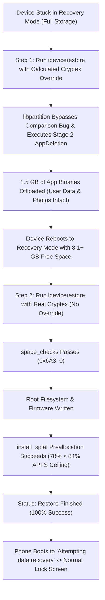

# iPhone Full-Storage Recovery Toolchain (Zero Data Loss)

> Recover iPhones stuck in Recovery Mode / boot loop due to 100% full flash storage (`Error 100 install_splat` or `Error 1110 space_checks`) **without erasing user data**.

---

## Background & The Core Bug

When an iOS device runs out of flash storage (0 GB free) and attempts an update or restarts, it can get stuck in a boot loop or Recovery Mode. When trying to restore or update via iTunes, Finder, or standard tools with "Preserve Data" enabled:

1. **APFS 84% Preallocation Ceiling (Error 100):**
   During restore, `restored` installs the system cryptex disk image (`Cryptex1,SystemOS`, e.g. `os.dmg` ~6.3 GB) on the Preboot volume using a single `fcntl(F_PREALLOCATE, F_ALLOCATEALL)` syscall. APFS rejects single contiguous preallocations exceeding ~**84.35%** of container free space, throwing:
   ```text
   Transfer: Failed preallocation of 6341787648 bytes for /mnt9/cryptex1/current/os.dmg: Unknown error: -1.
   Transfer: Failed preallocation due to space. No hope in this succeeding, bailing.
   CHECKPOINT FAILURE:(FAILURE:100) install_splat
   ```

2. **The Encrypted Storage Trap (Locked Device):**
   In locked Recovery Mode, Class C/B file protection hardware keys are unavailable. `restored`'s Stage 1 cleanup attempts to purge `/mnt2/mobile/Media/PhotoData` and `Syndication.photoslibrary`, but all deletions fail with:
   ```text
   libpartition: Could not reset metadata on /mnt2/mobile/Media/PhotoData/Thumbnails/: Operation not permitted
   ```
   Initial cleanup only frees ~12 KB.

3. **Apple's libpartition Comparison Bug (Error 1110):**
   `restored` has a Stage 2 cleanup mechanism (`AppDeletion`) that offloads third-party `.app` binaries from `/private/var/containers/Bundle/Application/` (keeping all user databases, photos, chats, and documents 100% intact).
   However, Apple's code contains a flawed comparison:
   ```c
   // Apple's buggy logic: compares total container free space against the shortfall
   if (ContainerFreeSpaceAfterInitialCleanup >= shortfall) {
       log("Sufficient space freed after initial cleanup. Skipping app deletion.");
   }
   ```
   When the shortfall is small (e.g. 150 MB), the container free space (e.g. 6.8 GB) is greater than 150 MB. The code mistakenly assumes enough space was freed, **skips AppDeletion**, and aborts with **Error 1110 (`ENOSPC`)**!

---

## The Solution: Two-Step Recipe for Locked Devices

By declaring a calculated `Cryptex1,SystemOSSize` override, we force `shortfall > ContainerFreeSpace`. This bypasses Apple's comparison bug, triggers Stage 2 `AppDeletion`, offloads 1–2 GB of third-party apps, and effortlessly clears the APFS 84% ceiling.



---

## Quick Start (Pre-Compiled Windows x64)

No compilation or MSYS2 installation required! A pre-compiled standalone package is included in [`bin/windows-x64/`](bin/windows-x64/):

1. **Prerequisites:**
   - Install **iTunes** (direct installer from Apple, not Microsoft Store) so Apple Mobile Device drivers are active.
   - Close iTunes and 3uTools completely so they do not interrupt USB communication.

2. **Step 1: Force Stage 2 AppDeletion:**
   Open PowerShell in the repository root:
   ```powershell
   $env:IDEVICERESTORE_CRYPTEX_SIZE_MIB = "13660"
   .\bin\windows-x64\idevicerestore.exe -y -P -i <YOUR_ECID> "D:\path\to\firmware.ipsw"
   ```
   - `libpartition` will delete ~1–2 GB of `.app` bundles from `/private/var/containers/Bundle/Application/`.
   - The run will end after `space_checks` with Error 1110, and the phone will automatically reboot back into Recovery Mode.

3. **Step 2: Full Data-Preserving Restore:**
   Once the phone screen returns to the Recovery Mode screen (cable + computer logo):
   ```powershell
   Remove-Item Env:\IDEVICERESTORE_CRYPTEX_SIZE_MIB
   .\bin\windows-x64\idevicerestore.exe -y -P -i <YOUR_ECID> "D:\path\to\firmware.ipsw"
   ```
   - Root OS filesystem restores.
   - Firmware (Baseband, Rose, Savage, SEP) flashes.
   - `install_splat` succeeds!
   - Output: `Status: Restore Finished` (100%).

---

## Building from Source

### On Windows (MSYS2 UCRT64)
Run the automated build script:
```bash
./scripts/build_toolchain_msys2.sh
```

### On macOS
```bash
brew install libplist libimobiledevice-glue libusbmuxd openssl libzip
git clone https://github.com/libimobiledevice/libtatsu.git && cd libtatsu && ./autogen.sh && make && sudo make install && cd ..
git clone https://github.com/libimobiledevice/libirecovery.git && cd libirecovery && ./autogen.sh && make && sudo make install && cd ..
git clone https://github.com/libimobiledevice/libimobiledevice.git && cd libimobiledevice && ./autogen.sh --without-cython && make && sudo make install && cd ..
git clone https://github.com/libimobiledevice/idevicerestore.git && cd idevicerestore
git checkout 60192e9
git apply ../patches/0001-restore-Allow-overriding-the-declared-Cryptex1-SystemOSSize.patch
./autogen.sh && make && sudo make install
```

---

## Post-Restore Sequence: What to Expect

1. **"Swipe up to recover":**
   After the restore completes, the iPhone displays the Apple logo with a progress bar, followed by a white screen: **"Swipe up to recover"**.
2. **Enter Passcode:**
   Swipe up and enter your normal device passcode.
3. **"Attempting data recovery":**
   The phone will show a white screen reading **"Attempting data recovery"** with a slow progress bar.
   > [!IMPORTANT]
   > This process takes **20 to 50 minutes**. Do not unplug the cable or hard-reset the device.
4. **Normal Lock Screen:**
   The phone boots directly into your familiar **Lock Screen** with wallpaper, notifications, and data intact.
   - Third-party apps may show a cloud download icon next to their names. Their application code was offloaded, but their documents, login sessions, and chat databases remain 100% untouched. Tap them on Wi-Fi to re-download.

---

## Verified Success Metrics (iPhone 11 Pro Max, 64 GB)

| Metric | Before Fix | After Stage 2 AppDeletion | Final Restore |
| :--- | :--- | :--- | :--- |
| **Data Volume Usage** | 45,593 MB | 43,987 MB (-1,606 MB) | 43,987 MB |
| **Container Free Space** | 6,507 MB | **8,114 MB** (+1,607 MB) | Sufficient |
| **Cryptex Preallocation** | 6,342 MB / 6,507 MB (97.5%) | 6,342 MB / 8,114 MB (**78.16%**) | **PASSED (< 84.35%)** |
| **Result** | Error 100 (`install_splat`) | AppDeletion Succeeded | **Restore Finished (100%)** |
| **User Data** | Preserved | Preserved | **100% Intact** |

---

## Credits & References

- Initial Cryptex patch and APFS ceiling analysis by [3SENN/iphone-stuck-in-recovery-full-storage](https://github.com/3SENN/iphone-stuck-in-recovery-full-storage).
- Upstream restore suite by [libimobiledevice](https://github.com/libimobiledevice/idevicerestore).
- Stage 2 `AppDeletion` breakthrough & two-step recipe by **khosa76**.
